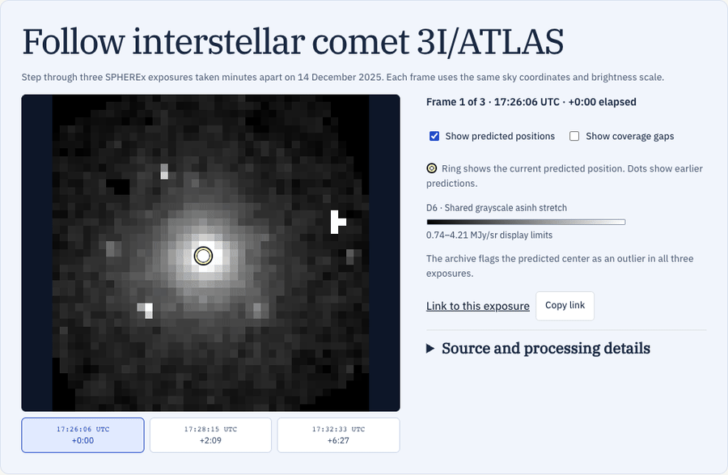
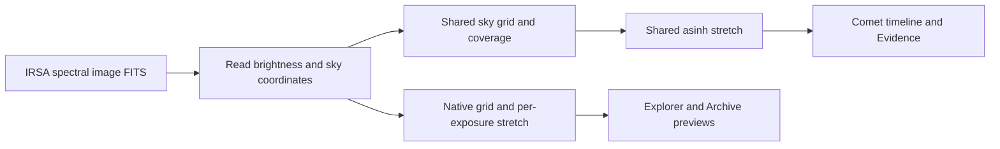

# AETHERTRACE

A SPHEREx observation explorer built for the NASA Space Apps **Planet X and SPHEREx** challenge. Step through infrared exposures, inspect archive quality flags, and trace each preview back to its source.

[Open the public AETHERTRACE demo](https://aethertrace.vercel.app/)



[Watch the 28-second submission demo](https://aethertrace.vercel.app/demo/aethertrace.mp4).

Try [3I/ATLAS](http://localhost:3000/comet) after starting the app. Replay six exposures from two passes, reveal coverage gaps, and copy a link to the current exposure and overlays. In [Evidence](http://localhost:3000/evidence#barnard-example), the Barnard’s Star pair shows how mismatched wavelengths and flagged pixels can prevent a brightness measurement.

## Run the demo

Requires Python 3.11+ and Node.js 20.9+. Run the API and frontend in separate terminals from the repository root.

```sh
python3 -m venv .venv
. .venv/bin/activate
pip install -r services/api/requirements.txt
uvicorn services.api.app:app --port 8000
```

```sh
npm --prefix apps/web ci
AETHERTRACE_API_URL=http://127.0.0.1:8000 npm --prefix apps/web run dev
```

Open [Aethertrace](http://localhost:3000/). To try the saved demo, stop the API and open the site in a fresh browser session. The comet sequence, field composites, and five saved DR1 exposures still load. Choose **Show a single exposure** on the homepage or **Individual exposures** in Explorer. Barnard’s Star has two saved exposures. Andromeda, Orion, and the Pleiades have one each.

## How FITS becomes a preview



To rebuild either comet pass, download its three FITS cutouts linked under **Source and processing details** in chronological order. For the later pass, append `--manifest apps/web/public/observations/comet/later/processing.json` to the command. The script checks each input against the pinned SHA-256 before rendering.

```sh
PYTHONPATH=. .venv/bin/python scripts/render_comet_sequence.py path/to/first.fits path/to/second.fits path/to/third.fits
```

Render settings, source links, and checksums are recorded in the [first pass manifest](apps/web/public/observations/comet/processing.json), [second pass manifest](apps/web/public/observations/comet/later/processing.json), [Barnard manifest](apps/web/public/observations/barnard/processing.json), and [saved sky-field manifest](apps/web/public/observations/saved-exposures/manifest.json). The [observation audit](docs/observation-audit.md) explains the cutout request, resampling, quality flags, and scientific limits.

## Current status

- Live IRSA queries returned 934 SPHEREx DR1 Level-2 records across four sky fields on 2026-11-14. Barnard's Star returned 240, Andromeda 229, the Orion Nebula 241, and the Pleiades 224. Each field has observations in all six detector channels.
- The Next.js interface displays time-ordered cutout previews within a selected detector channel. The cutout center uses a fixed coordinate; Barnard's Star proper motion has not been applied, so the displayed cutouts are not verified as centered on the star.
- The API preserves unique product IDs, exposure intervals, wavelength bounds, channel, and source-row provenance. Comparisons remain `INSUFFICIENT_DATA`; no variability result is claimed. See [query evidence](docs/science-query-evidence.md) and [scientific feasibility](docs/scientific-feasibility.md).
- The Evidence page provides aligned blink previews alongside native-grid cutouts, FITS quality counts, source links, and the limits of visual comparison.
- Source code is available in the public [GitHub repository](https://github.com/Romone6/AETHERTRACE). The demo is live on [Vercel](https://aethertrace.vercel.app/).

## Developer reference

See [API setup](services/api/README.md) and [web app setup](apps/web/README.md).

See [architecture](docs/architecture.md), [decision log](docs/decision-log.md), [stream status](docs/agent-status.md), and [API contract](packages/contracts/openapi.yaml).

No cloud services or paid offers have been activated.

Infrastructure status: [local-first deployment boundary](docs/deployment.md), [NASA Space Apps 2026 submission readiness](docs/submission-readiness.md), and [Global Offers audit](docs/global-offers-ledger.md). CI currently lints the OpenAPI contract; it does not deploy an application.

Original project source code is available under [Apache 2.0](LICENSE). See [credits, third-party notices, and AI assistance](NOTICE.md).
